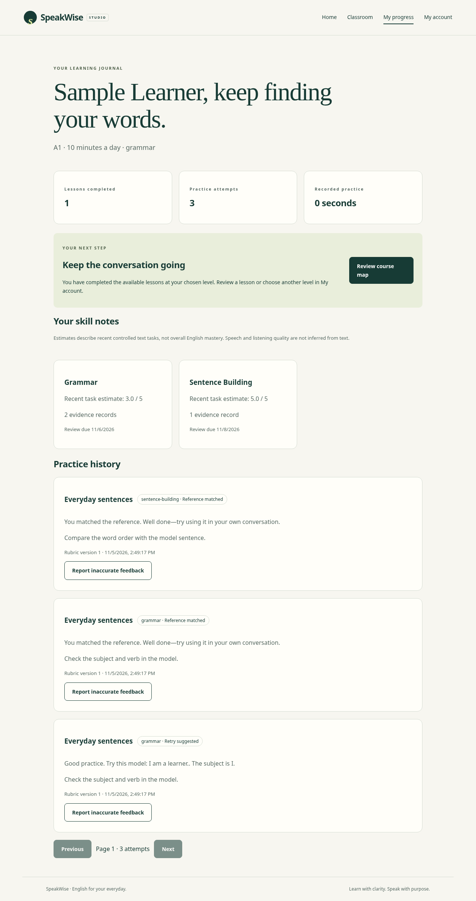

# SpeakWise AI

A guided English classroom: understand a small concept, practise it, receive useful feedback, retry, and see a clear next step.

**Status:** working local advisory pilot, implemented through the portfolio/documentation phase. Public release is blocked on live Neon/deployment configuration, verified email, educational review, and speech calibration. See the [phase-by-phase status](docs/release-status.md); reaching a phase's code does not mean every release gate is satisfied.



## What works

- Session-based accounts, goal/level preferences, text placement with explicit confidence and learner override.
- Versioned sample curriculum across pre-A1–B1, scripted teacher, contextual hints, controlled exercises, saved sessions, retry, and review.
- Optional bounded microphone capture, local playback, private asynchronous jobs, transcript/status flow, and safe disabled-provider fallback.
- Browser model speech with captions, slow playback, local voice preference, and disclosed opt-in online voices.
- Advisory progress by skill, evidence counts, review dates, explainable recommendations, and paginated history.
- Staff authoring/review/publication, separate reviewer, immutable historical versions, and feedback reporting.
- Consent withdrawal, data export, speech-result/account deletion, and retention cleanup.

Pronunciation scores are **not enabled**. Text matching measures controlled tasks, not overall proficiency; ASR is never treated as phoneme evidence. Visual pronunciation cues and sample lessons await qualified educational review. The initial audience is self-attesting learners aged 16+, with a small sample track rather than complete CEFR coverage. Child accounts and live group classrooms are out of scope.

## Run locally

Prerequisites: Python 3.12, Node 24/npm, Docker Engine with Compose v2. For host-side speech tests, install FFmpeg through your OS package manager. The containers include it.

```sh
python3 scripts/configure_local.py
make dev
```

This preserves an existing `.env`, creates private random local credentials only when needed, builds six services, applies migrations, and seeds fictional content. Open your local frontend on port 5173. API health is `/api/v1/health/` on port 8000; self-hosted API docs are `/api/v1/docs/` and schema `/api/v1/schema/`. No shared demo password is shipped; create an account through the UI.

```sh
make install       # locked host Python/frontend development dependencies
make check         # lint, format, migrations, schema, tests, strict types, build
cd frontend
CHROMIUM_PATH=/usr/bin/chromium npm run test:e2e
```

For Playwright without system Chromium, install its browser with `npx playwright install chromium` and omit CHROMIUM_PATH. The browser runner reuses local services or starts host services; ensure the database is configured/migrated first. `make stop` stops local containers while preserving volumes. See [development](docs/development.md) for full instructions.

## Neon and deployment

**Neon PostgreSQL is the selected hosted database.** Set its connection URL securely as DATABASE_URL; Neon connections enforce full TLS verification. No live Neon credentials or connection have been supplied. Local PostgreSQL remains the offline/CI fallback. See [Neon setup](docs/neon.md) and [production operations](docs/operations.md).

The production stack builds a static frontend served by Caddy with HTTPS and a private Gunicorn API, worker, scheduler, and Redis. A verified local TLS staging smoke passed against local PostgreSQL. Public hosting, actual Neon access, SMTP delivery, private production storage/backups, and restore still require operator configuration. No paid resource or cloud-environment publication was performed.

## Quality and cost

Validated: 31 backend tests, four frontend tests, two real Chromium journeys, tested-state axe checks on desktop/mobile, PostgreSQL migrations, real worker delivery, locked builds, and a four-user concurrent typed smoke. See [validation evidence](docs/validation.md) for limits and exact commands. Hosted GitHub Actions execution is not inferred from local passes.

Use free/open-source dependencies and a scripted teacher by default. A free optional offline transcription adapter is included; paid transcription is an optional disabled adapter. No API key is required for typed lessons or offline recognition. Browser online voices may use vendor services only after an explicit disclosure/opt-in. Hosting and provider free-tier limits must be checked separately.

## Project guide

| Area | Location |
| --- | --- |
| Django domain modules and tests | `backend/` |
| React/TypeScript app and browser tests | `frontend/` |
| Reproducible dependency snapshots | `requirements.lock`, `frontend/package-lock.json` |
| Local / production containers | `compose.yaml`, `compose.production.yaml`, `deploy/` |
| Product scope and phase history | [master plan](docs/master-plan.md), [delivery record](docs/phases.md) |
| Architecture and API contracts | [architecture](docs/architecture.md), [API guide](docs/api.md) |
| Learner / content guidance | [user guide](docs/user-guide.md), [authoring guide](docs/content-authoring.md) |
| Privacy and security | [privacy](docs/privacy.md), [threat model](docs/threat-model.md), [reporting](SECURITY.md) |
| Portfolio and remaining gates | [case study](docs/case-study.md), [release status](docs/release-status.md) |

Use synthetic lessons, fictional profiles, and generated test fixtures. Never commit real learner recordings, transcripts, personal information, or credentials. See [contributing](CONTRIBUTING.md). Licensed under [Apache 2.0](LICENSE).
