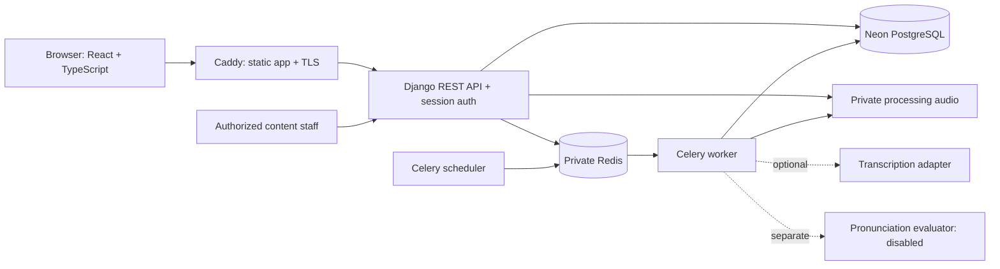

# Architecture

Development substitutes local PostgreSQL. Models use UUIDs for externally referenced learner/curriculum/session/attempt/assessment records. Django's internal auth user ID is never accepted as an ownership selector. Every learner resource is scoped to the authenticated user. Same-origin session auth uses CSRF for writes, including anonymous login/registration/reset requests.

The curriculum owns objectives, answer rules, model phrases, hints, rubrics, and versions. The classroom owns sequencing, idempotent attempts, turns, and save/resume. Assessment stores evidence and rubric/evaluator versions. Progress derives advisory controlled-text estimates and deterministic review reasons; it does not infer pronunciation from text.

Speech upload records require current consent and a speaking activity. Worker decoding validates duration before transcription. Optional providers are independent; disabled/mock states are explicit. Audio is private and short-lived; the scheduler cleans expiry and inactive learner sessions. Database and filesystem failure recovery/backup deletion obligations are operational concerns documented separately.

The deployment is a single-host modular monolith with replaceable Django storage/provider interfaces. Private object storage, live Neon connectivity, SMTP, and public DNS/TLS must be configured and verified before release. One scheduler should run; API and worker can scale only after storage, queue, connection budgets, and load tests support it.
